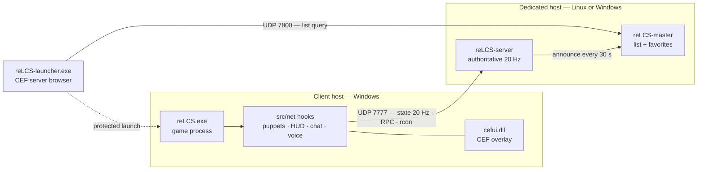
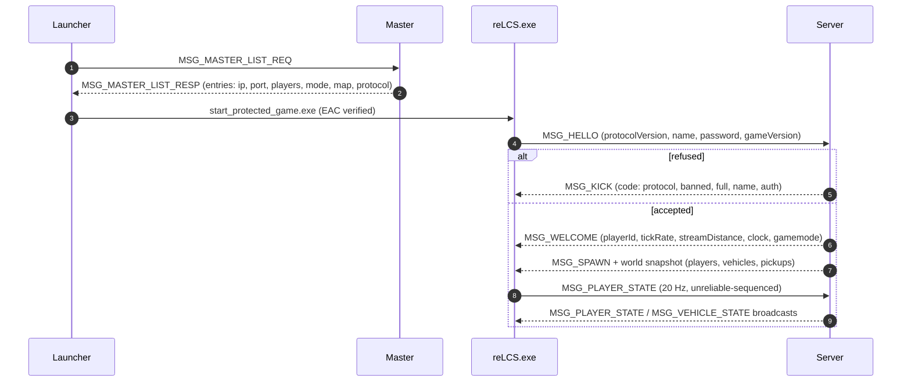
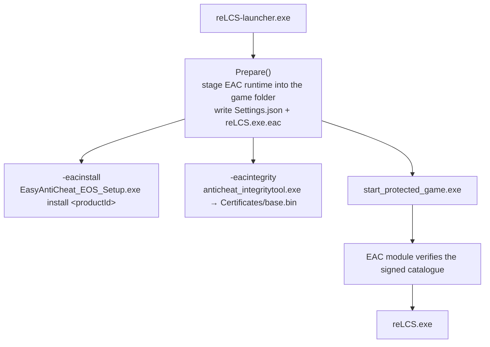
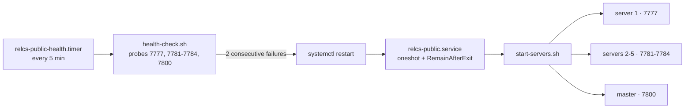

# reLCS Multiplayer

**A SA-MP-class multiplayer platform built into the GTA: Liberty City Stories reverse-engineering port.**

[](https://github.com/nobody71004/relcs-multiplayer/releases/tag/v0.3.2)
[](#9-the-protocol-v7)
[](#91-transport--channels)
[](#7-building-from-source)
[](LICENSE)
[](#121-the-public-fleet)

> A CEF launcher, an authoritative 20 Hz dedicated server, a NAT-safe master list with
> per-nickname favorites, Easy Anti-Cheat protected launch, and the game-side hooks that
> turn a single-player port into a persistent online world.

```
 v0.3.2   ·   protocol 7   ·   20 Hz authoritative   ·   UDP 7777 / 7778 / 7800   ·   ENet
```

---

## Contents

| | Section | | Section |
|---|---|---|---|
| 0 | [At a glance](#0-at-a-glance) | 9 | [The protocol (v7)](#9-the-protocol-v7) |
| 1 | [What this is](#1-what-this-is) | 10 | [The launcher](#10-the-launcher) |
| 2 | [Architecture](#2-architecture) | 11 | [Anti-cheat: EAC + EOS](#11-anti-cheat-eac--eos) |
| 3 | [Feature matrix](#3-feature-matrix) | 12 | [Deployment & operations](#12-deployment--operations) |
| 4 | [Quick start — players](#4-quick-start--players) | 13 | [Testing](#13-testing) |
| 5 | [Quick start — hosting](#5-quick-start--hosting) | 14 | [Release process](#14-release-process) |
| 6 | [Repository layout](#6-repository-layout) | 15 | [Troubleshooting](#15-troubleshooting) |
| 7 | [Building from source](#7-building-from-source) | 16 | [Roadmap & known gaps](#16-roadmap--known-gaps) |
| 8 | [Server reference](#8-server-reference) | 17 | [Docs index, credits, license](#17-docs-index-credits-license) |

---

## 0. At a glance

| Property | Value |
|---|---|
| **Base project** | reLCS — clean-room reimplementation of *GTA: Liberty City Stories* (`re3` / `librw` lineage) |
| **Multiplayer model** | Authoritative dedicated servers + central master list (SA-MP / MTA lineage) |
| **Wire protocol** | `PROTOCOL_VERSION` 7, [ENet](http://enet.bespin.org/) over UDP, 2 channels |
| **Simulation** | 20 Hz tick (`TICK_RATE`), state broadcast inside a 200 m AOI by default |
| **Transports / ports** | `7777/udp` game + in-band RCON · `7778/udp` LAN discovery · `7800/udp` master |
| **Max slots** | 32 per instance by default, 5 instances on the public host = 160 |
| **Persistence** | SQLite: `profiles.db` (wallet, weapons, stats, appearance, position) + `master.db` (favorites) |
| **Identity** | Nickname + optional password claim, PBKDF2-HMAC-SHA256, per-account salt |
| **Anti-cheat** | Client: Easy Anti-Cheat protected launch · Server: independent movement/state validator |
| **Client platform** | Windows x64 (D3D9 + OpenAL, CEF UI) |
| **Server platform** | Windows x64 and Linux x64 (no game assets required) |
| **Launcher** | Native CEF/Chromium GUI (`reLCS-launcher.exe`, ~2.9 MB release zip) |
| **License** | GNU GPL v3.0 |

---

## 1. What this is

reLCS is a clean-room reimplementation of **Grand Theft Auto: Liberty City Stories** —
the `re3` / `librw` lineage — extended with a complete multiplayer stack. The base game
still runs offline exactly as before; the `net/` tree adds everything needed to play it
online: launcher, master list, dedicated servers, bots, profiles, resource packs and
anti-cheat.

| Layer | Path | Responsibility |
|---|---|---|
| **Launcher** | `net/launcher/` | CEF/Chromium GUI: server browser, favorites, settings, EOS login, Easy Anti-Cheat state, protected launch |
| **Game client** | `src/net/` | Hooks into the port: HUD, chat, console, admin panel, character creator, ped/vehicle puppets, proximity voice, CEF overlay host |
| **Dedicated server** | `net/server/` | Authoritative 20 Hz simulation, movement validator, gamemodes, resource packs, static vehicles, in-band RCON, SQLite profiles |
| **Master** | `net/master/` | Server list (30 s announce / 90 s expiry) + per-nickname favorites in `master.db` |
| **Bot** | `net/bot/` | Scriptable scenario client (`roam`, `combat`, `fight`, `drive`, `cruise`, `chaos`, `solo`), master queries, RCON driver |
| **Agent bridge** | `net/agent/` | `reLCS-agentd`: HTTP/JSON control bridge + web HUD + OpenAI-style tool schema for LLM harnesses |
| **Network shaper** | `net/proxy/` | `net-shaper`: latency/jitter/loss injection used by the end-to-end suite |
| **Tests** | `net/tests/` | 3 392-check unit suite: protocol codecs, validator, profile store, resources, favorites |
| **Anti-cheat payload** | `net/eac/` | EAC runtime staging, `.eac` config, integrity catalogue tooling |

**What's actually in the box**

- A client that joins a server, sees other players move at 20 Hz, drives cars with scoped
  seat occupancy, fights, chats, talks over proximity voice and persists its character.
- A server you can run on a laptop or a VPS, with console + in-band RCON, gamemodes,
  resource packs and a movement validator that does not trust the client.
- A master that lists servers from anywhere, survives NAT, and remembers each player's
  favorites by nickname rather than by machine.
- A release pipeline (launcher zip + signed EAC integrity catalogue) and an operator
  run-book for the public fleet.

---

## 2. Architecture

### 2.1 Topology



### 2.2 Design rules

- **The server is authoritative.** Clients send inputs and their own reported state; the
  server validates, applies and broadcasts. Movement outside budget is flagged and
  corrected (`MSG_CORRECTION`) instead of trusted.
- **Clients need no open ports.** Every connection is client-initiated UDP, so home NAT
  and CGNAT are fine; only the server host needs reachable ports.
- **One binary per role, one set of headers.** `reLCS-server`, `reLCS-master`,
  `relcs-netbot`, the tests and the game client all compile the same `src/net/rnet_*`
  headers, so the wire format cannot drift between them.
- **The overlay is a process boundary.** The CEF UI (`cefui.dll` + `cefsub.exe`) only
  posts `lcs://` requests; the game applies them on its own main thread. RenderWare is
  never touched from Chromium threads — this is what the v0.3.0 freeze fix enforced.
- **Everything is observable.** `netstats_interval` logs bandwidth/RTT, the validator logs
  every rejection, the master logs every announce, and the launcher keeps an EOS bootstrap
  log next to the executable.

### 2.3 Join flow



### 2.4 Threading & process model

| Process | Threads | Notes |
|---|---|---|
| `reLCS.exe` | game main thread + audio + render | All world mutations happen on the main thread |
| `cefui.dll` | CEF UI + renderer subprocesses | Only marshals `lcs://` requests to the game thread |
| `reLCS-server` | one ENet host loop, 20 Hz | Simulation, validation, RCON and profiles are on the same loop |
| `reLCS-master` | one ENet host loop | Expiry sweep + SQLite favorites |

---

## 3. Feature matrix

| Area | Capability | State |
|---|---|---|
| World | 20 Hz player + vehicle sync inside `stream_distance` | ✅ shipping |
| World | Late-join snapshot (players, vehicles, clock, gamemode) | ✅ shipping |
| World | Ped puppets with appearance propagation | ✅ shipping |
| Vehicles | Enter/exit, seat occupancy, driver anchoring, static spawns | ✅ shipping |
| Combat | Damage, death, respawn flow, scoreboard (1 Hz `PLAYER_PING`) | ✅ shipping |
| Social | Chat, proximity voice (Opus, 40 m), admin broadcast banners | ✅ shipping |
| Identity | Nickname claim with password (PBKDF2-HMAC-SHA256) | ✅ shipping |
| Persistence | Wallet, weapons, score/kills/deaths, appearance, last position | ✅ shipping |
| Favorites | Master-side list keyed by nickname | ✅ shipping |
| Extensibility | Resource packs, `@on` hooks, command whitelist | ✅ shipping |
| Anti-cheat | EAC protected launch + per-folder integrity catalogue | ✅ shipping |
| Anti-cheat | Server-side movement/state validator | ✅ shipping |
| Anti-cheat | EOS server anti-cheat session + message relay | 🚧 planned (§16) |
| Tooling | Scenario bots, net-shaper, HTTP agent bridge | ✅ shipping |
| Platform | IPv6 | 🚧 not supported |

<details open>
<summary><b>World sync & simulation</b></summary>

- 20 Hz state + vehicle replication inside the AOI radius (default `200 m`).
- Ped puppets are driven by replicated state; vehicle puppets carry owner id, door state,
  seat occupancy and driver/passenger anchoring.
- Late joiners receive a full snapshot: players, vehicles, world clock, gamemode state.
- "Game-driven move" detection re-asserts spawns and lands teleports on loaded ground.
</details>

<details open>
<summary><b>Anti-cheat (server side)</b></summary>

- Movement validator: per-tick speed, vertical and delta budgets with a violation counter
  and a kick threshold; teleport floods are windowed (`5 s`, `200` events).
- Rejection of insane state, packet floods, chat spam, money edits and malformed payloads.
- RCON-authenticated admins are exempt, because noclip legitimately exceeds the budgets.
- Structured logging: `[anticheat] <name> …` lines land in the server log for review.
</details>

<details open>
<summary><b>Identity & persistence</b></summary>

- SQLite player profiles (`profiles.db`), one row per nickname:
  wallet, current weapon, full weapon table, `score` / `kills` / `deaths`, chosen
  **appearance** (ped model + 8 component slots) and last on-foot position + heading.
- First join may **claim** a nickname; after that the stored PBKDF2-HMAC-SHA256 hash
  (16-byte salt, 32-byte hash) gates it. Plaintext is never stored.
- Refusals are typed, not stringly: `REFUSE_AUTH` (claimed name, wrong/missing password),
  `REFUSE_PASSWORD` (password too short to claim), `REFUSE_NAME`, `REFUSE_FULL`,
  `REFUSE_BANNED`, `REFUSE_PROTOCOL`.
- Profiles save on disconnect and every 10 s while dirty; favorites live in the master
  (`master.db`, max 64 entries per nickname) so a player's list follows them to any machine.
</details>

<details open>
<summary><b>In-game UI</b></summary>

- CEF overlay panels: chat, developer console, inventory, admin panel, character creator.
- Configurable keybinds via `keybinds.ini` (written with defaults on first run).
- Scoreboard (hold `TAB`) with ping and score, pushed ~1 Hz by the server.
- Proximity voice via `MSG_VOICE`: 8 kHz mono, 20 ms Opus frames, 40 m range, 20 kbit/s.
</details>

<details open>
<summary><b>Server extensibility</b></summary>

- **Resource packs** — `resources/<pack>/resource.cfg` manifest plus `*.rsc` scripts with
  `@on start | join | leave | interval <s> | cmd <name>` hooks; `type=external` runs
  against a command whitelist, `type=internal` gets full command access. `%id%`, `%name%`
  and `%args%` are expanded per call.
- **Static vehicles** — `vehicles.cfg`, one `<model> <x> <y> <z> [heading]` per line.
- **Gamemodes** — `survivor` (first to 20 kills or 5-minute score win, round banners, auto-restart) and `freeroam`.
- **World clock / weather** — `hour`, `minute`, `weather` plus admin overrides.
</details>

<details open>
<summary><b>Automation & agent bridge</b></summary>

`reLCS-agentd` (Windows) holds one persistent ENet control connection to a server, logged
in as `Agent` with RCON auth, and exposes it over HTTP/JSON:

| Endpoint | Purpose |
|---|---|
| `GET /` | web HUD (server state, inventory, admin panel) |
| `GET /v1/tools` | OpenAI-style tool schema for an LLM harness |
| `GET /v1/status` | live server state (status + inventory + netstats) |
| `POST /v1/rcon` | run a server command |
| `POST /v1/say` | broadcast chat |
| `POST /v1/give` | money / weapon / god / health on a target |
| `POST /v1/bot` | spawn a scenario bot |

`/v1/*` requires `X-Rcon: <password>` (or a `password` body field).
CLI: `-http <port> -server <host:port> -rcon <pw> [-bot_exe <path>] [-web <path>] [-selftest]`.
</details>

---

## 4. Quick start — players

1. **Get the launcher** from [Releases](https://github.com/nobody71004/relcs-multiplayer/releases/tag/v0.3.2):
   `reLCS-launcher-v0.3.2-win64.zip` (~174 MB).
2. **Unzip anywhere** — the package is self-contained: it ships Chromium, the EOS SDK,
   the MSVC runtime and the EAC payload, so it opens on a machine with no game folder and
   no redistributables. Unzipping over an old launcher folder keeps `launcher.ini`.
3. **Point it at your game folder** in Settings (or `-game "C:\path\reLCS\reLCS.exe"`).
   The game install supplies `reLCS.exe` and its data; the launcher's own UI needs nothing
   from it.
4. **Optional EOS login** — copy `eos.ini.example` to `eos.ini` and fill in your product's
   client id/secret. Without it the launcher still lists and joins servers; only the EOS
   identity steps report `client-credentials-missing`.
5. **Pick a server and join.** First join opens the character creator: pick a ped, press
   **Done**, and the look is stored in your profile and sent to the server.

**Default keybinds** (`keybinds.ini`, written next to the executable on first run):

| Action | Default | Action | Default |
|---|---|---|---|
| Chat | `T` | Console | `F7` |
| Admin panel | `F6` | Second console key | `` ` `` |
| Inventory | `I` | Voice mute | `F9` |
| Scoreboard (hold) | `TAB` | — | — |

Accepted key names: `A-Z 0-9 F1-F12 ESC TAB SPACE ENTER BACKSPACE UP DOWN LEFT RIGHT
SHIFT CTRL ALT GRAVE SEMICOLON PLUS MINUS COMMA PERIOD SLASH LBRACKET RBRACKET QUOTE`.

**Nickname ownership.** Join with a password (launcher field or `-password` on the bot /
`reLCS.exe`) the first time and you claim that nickname; after that the same password
restores your wallet, weapons, stats, character and last position on any server.

---

## 5. Quick start — hosting

```bash
# Linux host — no game assets required
cd net && ./build-linux.sh

# master + one 32-slot survivor server
./bin/reLCS-master -port 7800 &
./bin/reLCS-server -hostname "My Server" -port 7777 -maxplayers 32 \
                   -gamemode survivor -announce 1 -master 127.0.0.1 -master_port 7800 \
                   -rcon_password 'change-me' -lan_discover 0
```

Windows equivalents are the same programs (`reLCS-server.exe`, `reLCS-master.exe`) in
`net\bin\Release\`.

Verify the public listing with the bot:

```bash
./bin/relcs-netbot -master-query -server <master-host>:7800
# [MASTER] <ip>:<port> "My Server" 3/32 mode=survivor
# [BOT] RESULT: PASS master_entries=N
```

Ports, all **UDP**:

| Port | Purpose | Internet-facing |
|---|---|---|
| `7777` | Game traffic + in-band RCON | yes |
| `7778` | LAN discovery broadcast | **no** — set `lan_discover=0` on a VPS |
| `7800` | Master list queries + server announces | yes |

Firewall (ufw): `ufw allow 7777/udp`, `ufw allow 7800/udp`, restrict SSH. Some VPS images
run a default-DROP `INPUT` allowlist instead of ufw — check `iptables -L INPUT -n` before
blaming the server.

---

## 6. Repository layout

```
reLCS/
├── src/                    game port (engine, game systems, hooks)
│   └── net/                multiplayer client
│       ├── nethooks.cpp        HUD/chat/console/admin/creator, puppets, appearance
│       ├── netclient.cpp       ENet transport, handshake, reliable channels
│       ├── rnet_common.h       wire structs, MsgType, PROTOCOL_VERSION, limits
│       ├── rnet_protocol.h     codecs (BitWriter/BitReader), read/write helpers
│       ├── rnet_validator.h    movement/state validator
│       └── rnet_voice.h        Opus proximity voice
├── net/
│   ├── launcher/           CEF launcher (main.cpp, launcher.html, eac/, eos bootstrap)
│   ├── server/             dedicated server (world, gamemode, profiles, resources)
│   ├── master/             server list + favorites (SQLite)
│   ├── bot/                scenario bot / load + query tool
│   ├── agent/              reLCS-agentd HTTP bridge + web HUD
│   ├── proxy/              net-shaper (latency/jitter/loss injection)
│   ├── tests/              3 392-check unit suite
│   ├── cefui/              cefui.dll: Chromium host + game UI pages
│   ├── eac/                Easy Anti-Cheat payload (runtime, .eac, integrity cfg)
│   ├── deploy/proxmox/     LAN host: master + 5 instances, pid files, run-book
│   ├── internet-test/      NAT/VPS run-book, staging units, dry-run report
│   ├── docs/               EAC integration plan
│   ├── build-linux.sh      Linux server/master/bot/tests build
│   └── e2e.sh              phased end-to-end run-book (phases 0-6)
├── docs/                   modding notes (BMW i8 model + door chime)
├── patches/                required librw fix (geometry read guard)
├── vendor/                 enet, sqlite, librw (submodule), eos-sdk
├── premake5.lua            Windows/VS project generation
├── net/premake5.lua        net stack project generation
└── gamefiles/              optional game-side data
```

---

## 7. Building from source

### 7.1 Windows (Visual Studio 2022 / MSBuild)

```bat
:: generate the solutions (toolset v143 is preset in both premake scripts)
premake-vs2019.cmd            :: wraps: premake5.exe vs2019 --with-librw
```

```bat
:: game client (D3D9 + OpenAL)
msbuild build\reLCS.sln -p:Configuration=Release -p:Platform=win-amd64-librw_d3d9-oal -m
:: output: bin\win-amd64-librw_d3d9-oal\Release\reLCS.exe  (+ cefui.dll, cefsub.exe)

:: net stack (server, master, bot, agent, shaper, tests, launcher)
msbuild net\build\reLCS-net.sln -p:Configuration=Release -p:Platform=x64 -m
:: output: net\bin\Release\
```

Notes:

- Clone with `--recursive` — librw is a submodule.
- Point `GTA_LCS_RE_DIR` at a game folder to have the post-build step copy the executable.
- 64-bit D3D9 needs the Microsoft Dx9 SDK headers if they are not already installed.
- OpenAL builds: see the upstream wiki page *Running OpenAL build on Windows*.
- `LIBRW` can point at your own librw checkout instead of `vendor/librw`.

Other premake platforms declared in `premake5.lua`: the full `win-x86-*` and `win-amd64-*`
set (RW34/d3d8, librw/d3d9, librw/gl3), `linux-{x86,amd64,arm,arm64}-librw_gl3_glfw-oal`,
the `bsd-*` set and `macosx-{amd64,arm64}`. Only the D3D9/OpenAL win-amd64 build carries
the multiplayer client hooks.

### 7.2 Linux (server side only)

```bash
cd net && ./build-linux.sh
# -> net/bin/{reLCS-server, reLCS-master, relcs-netbot, relcs-net-tests}
CC=clang CXX=clang++ ./build-linux.sh      # alternative toolchain
```

### 7.3 Produced binaries

| Binary | Role | Platform |
|---|---|---|
| `reLCS.exe` | game client | Windows x64 |
| `cefui.dll`, `cefsub.exe` | CEF overlay host + subprocess | Windows x64 |
| `reLCS-launcher.exe` | launcher / server browser | Windows x64 |
| `reLCS-server` | dedicated server | Windows + Linux x64 |
| `reLCS-master` | master list | Windows + Linux x64 |
| `relcs-netbot` | scenario bot / query tool | Windows + Linux x64 |
| `net-tests.exe` / `relcs-net-tests` | unit suite | Windows + Linux x64 |
| `net-shaper` | network degradation shim | Windows |
| `reLCS-agentd` | HTTP agent bridge | Windows |

### 7.4 Runtime portability (Linux)

`build-linux.sh` links the C++ runtime statically (`-static-libstdc++ -static-libgcc`), so
a binary built with a newer GCC still starts on an older distro (Ubuntu 24.04 ships
`GLIBCXX_3.4.32`; a GCC 15 build would otherwise want `3.4.34`). `libopus` is required for
the voice path used by the bot and the tests. If a target image is even older, ship
`libstdc++.so.6` + `libgcc_s.so.1` next to the binaries and launch with `LD_LIBRARY_PATH`.

### 7.5 Required patch

`patches/librw-geoplg-readmesh-guard.patch` must be applied inside `vendor/librw`. It
bounds the geometry mesh index/material reads; without it, malformed or truncated mod
files become out-of-bounds reads that crash much later in the D3D9 renderer.

### 7.6 Compile-time configuration

Switches live at the bottom of `src/core/config.h` (`FIX_BUGS` fixes the bugs found so
far, including the non-exclusive DirectInput mouse level the multiplayer UI relies on).

---

## 8. Server reference

### 8.1 `server.cfg` keys (also accepted as `-key value` on the CLI)

| Key | Default | Notes |
|---|---|---|
| `hostname` | `reLCS Server` | shown in the launcher list |
| `port` | `7777` | game traffic **and** RCON, UDP |
| `maxplayers` | `32` | |
| `gamemode` | `survivor` | `survivor` \| `freeroam` |
| `announce` | `0` | **bool** — list this server on the master |
| `master` | `127.0.0.1` | master host to announce to |
| `master_port` | `7800` | master UDP port |
| `public_ip` | *(empty)* | WAN address to advertise instead of the LAN IP (port-forwarded hosts) |
| `lan_discover` | `1` | raw-UDP broadcast on 7778; disable on a VPS |
| `rcon_password` | *(empty)* | empty disables admin; the public fleet runs the shared default `relcs-admin-2026` (`DEFAULT_RCON_PASSWORD` in `rnet_common.h`) so a stock launcher can open the admin panel — rotate it for your own server and pass `-rcon <pw>` to the client |
| `stream_distance` | `200` | state-sync radius in metres |
| `tick_rate` | `20` | simulation ticks per second |
| `hour`, `minute`, `weather` | `12`, `0`, `0` | world clock |
| `netstats_interval` | `0` | `>0` logs bandwidth/RTT every N seconds |
| `profiles` | `profiles.db` | SQLite path; empty disables |
| `resources` | `resources` | resource-pack directory; empty disables |
| `vehicles` | `vehicles.cfg` | static spawn list; empty disables |

Map name defaults to `Liberty City` and is shown in the launcher's server tooltip.

> **CLI pitfall:** `announce` is a bool, so `-announce 192.168.0.213:7800` parses as *true*
> and leaves `master` at `127.0.0.1`. Always pass
> `-announce 1 -master <host> -master_port <port>`.

### 8.2 Console & RCON commands

The server console and in-band RCON share one dispatcher; `help` prints the full list.

| Group | Command | Syntax / effect |
|---|---|---|
| Session | `status` | `hostname=… players=…/… mode=… map=… uptime=… tick=…` |
| | `players` | per-player id, name, IP, score, K/D, ping, alive/dead |
| | `uptime`, `version` | process uptime; server protocol + game id |
| | `netstats` | per-peer RTT and loss |
| | `kick` | `kick <id> [reason]` |
| | `ban` / `banip` | `ban <id>` bans that player's IP; `banip <addr>` bans an address |
| | `unban` | `unban <addr>` |
| | `respawn` | `respawn <id>` — re-enter the spawn flow for that player |
| | `teleport` | `teleport <id> <x> <y> <z>` — server-side move, does not trip the validator |
| Gamemode | `gmx` | restart the current gamemode |
| | `loadmode` | `loadmode survivor\|freeroam` |
| World | `settime` | `settime <hour 0-23> <minute 0-59>` |
| | `setweather` | `setweather <0-5>` — 0 sunny, 1 cloudy, 2 rainy, 3 foggy, 4 extra-sunny, 5 hurricane |
| | `spawnbot` | `spawnbot <name> [roam\|combat\|drive\|chaos]` |
| | `spawnprop` | `spawnprop <x> <y> <z> [weaponType] [qty]` |
| | `spawncar` | `spawncar <model> [<playerId> \| <x> <y> <z> [heading]]` |
| | `cars`, `delcar` | list spawned vehicles; `delcar <id>\|all` |
| | `give` | `give <id\|name> money\|weapon\|god\|health <value> [ammo]` |
| | `setr`, `getr` | `setr <key> <value>` / `getr` — live server variables (`stream_distance`, `tick_rate`, clock, weather) |
| Communication | `say <text>` | broadcast a `[SERVER]` chat line |
| | `broadcast <text>` | on-screen banner for every client |
| Resources | `res` (alias `resources`) | `res list\|info\|enable\|disable\|reload\|run\|install\|uninstall\|log` |
| Process | `exec <file>` | run a command file |
| | `quit`, `exit` | shut the server down |

RCON rides the game's own UDP port in-band: a player authenticates with
`rconauth <password>` (or `login`), then sends `rcon <command>`. Authenticated admins are
exempt from the movement validator and get the in-game admin panel (`F6`).

### 8.3 Static vehicles — `vehicles.cfg`

```
<model> <x> <y> <z> [heading]
285 1178.0 -672.0 23.0 90.0
```

### 8.4 Resource packs

```
resources/
└── mypack/
    ├── resource.cfg     ; name, version, author, description, type, autoload, motd
    └── main.rsc         ; @on start | join | leave | interval 30 | cmd hello
```

Scripts run ordinary server commands; `%id%`, `%name%` and `%args%` are expanded.

### 8.5 Gamemodes & world

- `survivor` (**Liberty City Survivor**) — round-based deathmatch: first to **20 kills**
  or highest score at the **5 minute** mark wins; `GMEV_ROUND_START` / `GMEV_ROUND_END`
  drive the client banners, and the next round starts after a 5 s intermission.
- `freeroam` — no round state; respawn immediately, score still tracked.
- Built-in spawn set: eight Liberty City (Portland-area) points clustered within ~150 m so
  players are inside each other's 200 m AOI from the first frame. The spawn message carries
  the player's own model, so the chosen appearance survives respawns.
- The world clock (`hour`, `minute`) and `weather` are authoritative: the server pushes
  them on join and after every `settime` / `setweather`.

---

## 9. The protocol (v7)

`PROTOCOL_VERSION` lives in `src/net/rnet_common.h`. A mismatch is refused with
`REFUSE_PROTOCOL`, so client and server builds must come from the same line of the tree.

### 9.1 Transport & channels

| Property | Value |
|---|---|
| Transport | ENet over UDP, one connection per client |
| `CHAN_RELIABLE` (0) | handshake, RPCs, chat, gamemode events, RCON |
| `CHAN_STATE` (1) | unreliable-sequenced state snapshots |
| Tick | 20 Hz (`TICK_RATE`), `TICK_DT = 0.05 s` |
| Default game port | `7777` (`DEFAULT_PORT`) |
| Default master port | `7800` (`DEFAULT_MASTER_PORT`) |
| Discovery port | `7778` (`DISCOVERY_PORT`) |

### 9.2 Message ids

| Range | Messages |
|---|---|
| **Session** | `HELLO` 1, `WELCOME` 2, `DISCONNECT` 3, `PING` 4, `PONG` 5 |
| **Entities** | `PLAYER_JOIN` 10, `PLAYER_QUIT` 11, `PLAYER_STATE` 12, `VEHICLE_STATE` 13 |
| **RPC** | `CHAT` 20, `SPAWN_REQ` 21, `SPAWN` 22, `DEATH` 23, `DAMAGE` 24, `KICK` 25, `CORRECTION` 26, `GIVE` 27 |
| **Vehicles** | `VEH_ENTER` 30, `VEH_EXIT` 31, `VEH_SPAWN` 32, `VEH_DESPAWN` 33 |
| **Profile** | `INVENTORY` 34, `APPEARANCE` 35 (ped model + 8 component slots, both directions) |
| **World** | `WORLD` 40, `SCORE_UPDATE` 41, `GAMEMODE_EVENT` 42, `PICKUP_SPAWN` 43, `PICKUP_COLLECT` 44, `RES_LIST` 45, `VOICE` 46, `PLAYER_PING` 47 |
| **Admin** | `RCON_AUTH` 50, `RCON_OK` 51, `RCON_CMD` 52, `RCON_RESP` 53 |
| **Master** | `MASTER_ANNOUNCE` 80, `MASTER_LIST_REQ` 81, `MASTER_LIST_RESP` 82, `MASTER_FAV_LIST` 83, `MASTER_FAV_ADD` 84, `MASTER_FAV_DEL` 85, `MASTER_FAV_RESP` 86 |

### 9.3 Join refusals

| Code | Name | Meaning |
|---|---|---|
| 0 | `REFUSE_NONE` | generic kick (reason text only) |
| 1 | `REFUSE_PROTOCOL` | `protocolVersion` mismatch |
| 2 | `REFUSE_BANNED` | IP banned |
| 3 | `REFUSE_FULL` | server at `maxPlayers` |
| 4 | `REFUSE_NAME` | nickname rejected |
| 5 | `REFUSE_AUTH` | nickname is claimed and the password was wrong or missing |
| 6 | `REFUSE_PASSWORD` | password rejected (for example too short to claim) |

### 9.4 Validation limits

Every state packet is checked against the last accepted state by `rnet_validator.h`.
Rejections increment a per-player counter (visible as `flags=` in the log); repeated
violations kick.

| Limit | Value |
|---|---|
| Max on-foot speed | `15 m/s` |
| Max fall speed | `40 m/s` downward (drops and ragdolls are legitimate physics) |
| Max vehicle speed | `95 m/s` |
| Default AOI radius | `200 m` (`STREAM_DISTANCE`) |
| Teleport flood guard | `200` client-flagged teleports per `5 s` window |

The validator is unit-tested against crafted payloads in `net/tests/`.

### 9.5 Proximity voice

| Property | Value |
|---|---|
| Codec | Opus, variable-length packets, `MSG_VOICE` |
| Sample rate | 8 kHz mono (mu-law equivalent used 64 kbit/s) |
| Frame | 20 ms = 160 samples |
| Max packet | 160 bytes |
| Target bitrate | 20 kbit/s |
| Hearing radius | 40 m, relayed by the server |

### 9.6 Master semantics

- Servers announce every **30 s**, retrying every **5 s** while disconnected; entries
  expire **90 s** after the last announce (three missed announces).
- Entries are keyed by the **observed source IP** of the announce — NAT-safe by
  construction: whatever public IP the announce exits from is what clients receive.
- If the observed source is loopback (server and master on one box), the master falls back
  to the `advertisedIp` in the announce — `public_ip` when set, otherwise the first
  RFC1918 address. On hosts with docker/libvirt bridges that can be a bridge address,
  which is why production fleet configs set `master=<public-ip>` or `public_ip=<public-ip>`.
- The launcher list is `MASTER_LIST_REQ` → `MASTER_LIST_RESP`, carrying ip, game port,
  players/max, ping, hostname, gamemode, map name and protocol version (so stale servers
  can be flagged as incompatible instead of silently failing to connect).

---

## 10. The launcher

Chromium/CEF GUI (`net/launcher/`): server browser (master list, LAN discovery, direct
connect), ping/probe, favorites, settings, EOS status, and the join flow that hands off to
`start_protected_game.exe` when anti-cheat is active.

### 10.1 CLI

| Flag | Purpose |
|---|---|
| `-join <ip:port>` | join a server immediately |
| `-nick <name>` | nickname for this session |
| `-master <host[:port]>` | master to query and save |
| `-game <path>` | game executable (skip auto-detection) |
| `-query "<op>"` | run one raw UI operation and print the reply |
| `-selftest` | headless self-checks (master + LAN queries) |
| `-eostest` | run the EOS bootstrap and report each step |
| `-eacinstall` | install/repair the Easy Anti-Cheat service (needs admin) |
| `-eacintegrity` | sign the integrity catalogue for the game folder |

### 10.2 Files next to the launcher

| File | Purpose |
|---|---|
| `launcher.ini` | game path, nickname, master, RCON password (kept across upgrades; an empty `rcon` falls back to the fleet default) |
| `eos.ini` | EOS product client id/secret (`eos.ini.example`) |
| `eac/` | EAC payload: `runtime/`, `reLCS.exe.eac`, `integrity.cfg`, public certificate |
| `favorites.ini` | local cache only — the master owns the real list |

---

## 11. Anti-cheat: EAC + EOS



- **Protected launch is the default join path** on the public fleet. The bootstrapper
  verifies the game against the signed catalogue, then starts `reLCS.exe`.
- **The catalogue is per game folder.** `integrity.cfg` hashes game data and binaries
  (excluding logs, saves, configs, screenshots, `eos-cache`). Replacing `reLCS.exe` or game
  data invalidates it — re-sign or EAC refuses the launch:
  ```powershell
  reLCS-launcher.exe -game "C:\path\reLCS\reLCS.exe" -eacintegrity
  ```
- **The signing key is never shipped.** Release zips carry the runtime, the `.eac` CDN
  config, `integrity.cfg` and the *public* certificate only.
- **EOS login is a separate concern.** The launcher bootstraps the SDK and signs in via
  Connect; every step is shown in the UI and appended to `eos-bootstrap.log`. EOS 1.19
  refuses platform creation without a client credential pair.
- **Server-side EOS anti-cheat** (`EOS_AntiCheatServer_BeginSession` + message relay) is not
  wired into `net/server` yet — see §16. The servers currently rely on the reLCS validator,
  which is independent of EAC.

---

## 12. Deployment & operations

### 12.1 The public fleet

| Role | Host | Port | Unit |
|---|---|---|---|
| Master (+ favorites DB) | `88.214.59.166` | UDP `7800` | `relcs-public.service` |
| `reLCS Public` | `88.214.59.166` | UDP `7777` | same unit, `servers/1.cfg` |
| `reLCS Public #2 … #5` | `88.214.59.166` | UDP `7781`–`7784` | same unit, `servers/2.cfg` … `5.cfg` |

All five instances run `gamemode=survivor`, `maxplayers=32`, `announce=1`,
`master=88.214.59.166`, `lan_discover=0`.

### 12.2 Host layout

```
/opt/relcs-public/
├── net/bin/        reLCS-server, reLCS-master, relcs-netbot
├── servers/        1.cfg … 5.cfg   (ports, hostnames, announce, rcon)
├── deploy/         start-servers.sh, stop-servers.sh, health-check.sh
├── logs/           master.log, server-1.log … server-5.log
├── run/            pid files
├── rcon.env        RCON password (EnvironmentFile for the unit)
└── master.db       favorites
```

### 12.3 Supervision



### 12.4 Deploy procedure

```bash
# 1. build on the host (g++ 13, statically linked C++ runtime)
cd /opt/relcs-build-lcs/net && ./build-linux.sh
./bin/relcs-net-tests          # expect: 3392 checks, 0 failures — PASS

# 2. install and restart
B=/opt/relcs-public/net/bin
install -o relcs -g relcs -m755 \
  /opt/relcs-build-lcs/net/bin/{reLCS-server,reLCS-master,relcs-netbot} "$B/"
systemctl restart relcs-public.service

# 3. verify
ss -lunp | grep -E ':(7777|778[1-4]|7800) '
"$B/relcs-netbot" -master-query -server 127.0.0.1:7800
#   expect: PASS master_entries=5, every entry on the public IP
tail -n3 /opt/relcs-public/logs/server-*.log
```

**Rollback:** copy the previous binaries back from `/opt/relcs-public/backup-<timestamp>/`
and `systemctl restart relcs-public.service`. Check for connected players first
(`relcs-netbot -master-query` shows the population per instance).

### 12.5 LAN / Proxmox host

`net/deploy/proxmox/start-servers.sh` brings up a master plus five 32-player instances with
pid files, per-instance configs and profile databases; `stop-servers.sh` shuts them down.
Port map, verification steps and the `@reboot` cron entry are in
[`net/deploy/proxmox/README.md`](net/deploy/proxmox/README.md).

### 12.6 NAT / firewall checklist

- [ ] The public IPv4 is on an interface (`ip -4 addr`), not behind CGNAT.
- [ ] UDP `7777` and `7800` (plus every extra instance port) reachable from the internet —
      provider security group **and** `ufw`/`iptables`.
- [ ] `lan_discover=0` on any internet-facing host.
- [ ] `master=<public-ip>` or `public_ip=<public-ip>` on same-box deployments.
- [ ] `nf_conntrack_udp_timeout >= 60` if the firewall tracks UDP.
- [ ] MTU 1500 unless tunneling — ENet reliable packets fragment.
- [ ] IPv4 only: the stack addresses nodes with 32-bit IPv4.

Full run-book: [`net/internet-test/RUNBOOK.md`](net/internet-test/RUNBOOK.md); field
results: [`net/internet-test/DRYRUN-REPORT.md`](net/internet-test/DRYRUN-REPORT.md).

---

## 13. Testing

| Suite | Command | Covers |
|---|---|---|
| Unit | `net/bin/relcs-net-tests` (Windows: `net\bin\Release\net-tests.exe`) | **3 392 checks, 0 failures**: codecs, validator, profile store, resources, favorites |
| End-to-end | `net/e2e.sh` | 10 steps across phases 0–6: unit tests → base sync (4 bots) → vehicle enter/drive → late joiner → LAN discovery → master list → launcher GUI self-test → degradation (100 ms ± 30 ms jitter, 2 % loss via `net-shaper`) → live game client → LLM agent pipeline |
| Bot scenarios | `relcs-netbot -server <ip:port> -scenario roam\|combat\|fight\|drive\|cruise\|chaos\|solo` | Load, movement, combat, driving, cruise, chaotic input, solo |
| Bot options | `-name -password -duration -seed -vehmodel -rcon -expect-chat -expect-world -voice -verbose -cmd -discover -master-query` | Deterministic scenarios, assertions, RCON driving, master queries |
| Mod smoke | `net/i8-smoke.sh` | Live server + client + bot spawn with a custom vehicle |
| Internet matrix | RUNBOOK §7 | T1–T7: list, direct connect, gameplay, RCON, two NATs, hairpin, 10 min soak |

The unit suite is the fastest way to confirm a cross-build: it links the same protocol
headers the server and client use.

---

## 14. Release process

1. **Land everything on `lcs`**, keeping `PROTOCOL_VERSION` in step with any wire change.
2. **Build the launcher** from that commit:
   ```bat
   msbuild net\build\reLCS-net.sln -p:Configuration=Release -p:Platform=x64 -t:net-launcher
   ```
3. **Package** with the release script — it stages every statically imported dependency
   and refuses to build an incomplete zip:
   ```powershell
   powershell -ExecutionPolicy Bypass -File net\launcher\package-release.ps1 -Version X.Y.Z
   # -> out/reLCS-launcher-vX.Y.Z-win64.zip
   ```
   The zip is **self-contained** (35 files, ~378 MB staged, ~174 MB compressed) and ships
   everything the process loads at startup:

   | Group | Files |
   |---|---|
   | Launcher | `reLCS-launcher.exe`, `launcher.html` |
   | CEF host | `cefui.dll`, `cefsub.exe` (browser subprocess) |
   | Chromium | `libcef.dll`, `chrome_elf.dll`, `chrome_100_percent.pak`, `chrome_200_percent.pak`, `resources.pak`, `icudtl.dat`, `v8_context_snapshot.bin`, `locales/en-US.pak`, `locales/en-GB.pak` |
   | GPU helpers | `d3dcompiler_47.dll`, `dxcompiler.dll`, `dxil.dll`, `vk_swiftshader.dll`, `vk_swiftshader_icd.json`, `vulkan-1.dll` |
   | Epic | `EOSSDK-Win64-Shipping.dll` |
   | MSVC runtime | `msvcp140.dll`, `vcruntime140.dll`, `vcruntime140_1.dll` |
   | EAC | `eac/` payload: runtime, `reLCS.exe.eac`, `integrity.cfg`, public cert, licences — **never** `keys/base_private.key` |

   The script fails instead of producing a partial zip; `PACKAGE-README.txt` inside the
   zip states the same inventory. Extra locales can be added with `-Locale en-US,de-DE,…`.
4. **Tag and publish:** `git tag -a vX.Y.Z -m "…"`, push the tag, `gh release create`.
5. **Deploy the servers** from the same commit (§12.4) — the protocol version in the
   release notes tells players whether they must update.

**Current release — v0.3.2:** the launcher zip is self-contained. v0.3.0 shipped the exe
alone (fatal: `EOSSDK-Win64-Shipping.dll` missing), v0.3.1 added the EOS SDK but not the
Chromium runtime (`libcef.dll` and friends), so this release bundles the whole CEF runtime,
`cefsub.exe`, the GPU helpers and the MSVC runtime as well, and defaults to the fleet RCON
password so the admin panel works without editing `launcher.ini`. Verified by unzipping
into an empty folder and running `-selftest`: `[SELFTEST] RESULT: PASS`, CEF page loaded,
five public servers listed. Carries v0.3.0: EAC protected launch, EOS login, character
appearance sync and the character-creator freeze fix.

---

## 15. Troubleshooting

| Symptom | Cause | Fix |
|---|---|---|
| Server never appears in the list | `announce` is a bool and the address went into the wrong key | `-announce 1 -master <host> -master_port <port>` |
| Master lists `172.17.0.1:port` instead of the public IP | docker/libvirt bridge chosen for a loopback announce | set `public_ip=<public-ip>` (or `master=<public-ip>`) |
| Client joins, then drops ~90 s later | window unfocused long enough for the ENet peer timeout | keep the game focused; watch `netstats_interval` |
| `version 'GLIBCXX_3.4.xx' not found` | binary linked against a newer libstdc++ | rebuild with `build-linux.sh` or ship `libstdc++.so.6` |
| EAC refuses the launch after replacing files | integrity catalogue is stale | `reLCS-launcher.exe -game <exe> -eacintegrity` |
| Overlay panels freeze the game | old build: DirectInput teardown + CEF callbacks off-thread | fixed in v0.3.0 — update the client |
| Launcher quits with `EOSSDK-Win64-Shipping.dll was not found` | v0.3.0 zip did not bundle the EOS SDK | use v0.3.2+, or drop `EOSSDK-Win64-Shipping.dll` next to `reLCS-launcher.exe` |
| Launcher exits silently or with `libcef.dll was not found` / a blank window | v0.3.1 bundled `cefui.dll` but not Chromium | use v0.3.2+ (ships `libcef.dll`, paks, `cefsub.exe`, locales) |
| CEF starts but its network service crash-loops | `resources.pak` / `v8_context_snapshot.bin` missing next to the launcher | use v0.3.2+, or copy both from the game folder |
| Admin panel says "not configured" | launcher passed no `-rcon` (empty `rcon` in `launcher.ini`) | v0.3.1+ defaults to the fleet password; otherwise set `rcon = <server rcon_password>` |
| `client-credentials-missing` in the launcher | no EOS client id/secret | fill `eos.ini` |
| Crash in the D3D9 renderer with modded models | missing librw read guard | apply `patches/librw-geoplg-readmesh-guard.patch` |
| Nickname rejected with "auth" | name claimed with a different password | use the original password, or pick another nickname |

---

## 16. Roadmap & known gaps

- **Server-side EOS anti-cheat** — `EOS_AntiCheatServer_BeginSession`, per-client
  registration and `OnMessageToServer` relay over the reLCS protocol
  ([`net/docs/EAC_INTEGRATION_PLAN.md`](net/docs/EAC_INTEGRATION_PLAN.md)).
- **IPv6** — the stack addresses nodes with 32-bit IPv4 only.
- **Launcher auto-update** — currently a manual zip replacement.
- **Resource sandbox** — external packs are command-whitelisted; finer-grained capability
  scoping is planned.
- **Master metadata** — map/mode are shipped; richer tags (rules, region, password flag)
  are not.

---

## 17. Docs index, credits, license

| Document | What it covers |
|---|---|
| [`MULTIPLAYER-PLAN.md`](MULTIPLAYER-PLAN.md) | Design and phasing of the multiplayer stack |
| [`net/internet-test/RUNBOOK.md`](net/internet-test/RUNBOOK.md) | Topology, ports, NAT traversal, staging deploy, test matrix |
| [`net/internet-test/DRYRUN-REPORT.md`](net/internet-test/DRYRUN-REPORT.md) | What the staged internet rehearsal actually proved |
| [`net/deploy/proxmox/README.md`](net/deploy/proxmox/README.md) | LAN host: master + 5 instances, ports, verification |
| [`net/docs/EAC_INTEGRATION_PLAN.md`](net/docs/EAC_INTEGRATION_PLAN.md) | Server-side EOS anti-cheat plan |
| [`docs/bmw-i8-integration.md`](docs/bmw-i8-integration.md) | Custom vehicle model pipeline + door chime |
| [`net/e2e.sh`](net/e2e.sh) | Executable end-to-end test run-book |
| [`CODING_STYLE.md`](CODING_STYLE.md) | Contribution style rules |

**Credits.** reLCS builds on the `re3` reverse-engineering project and **librw**, the
RenderWare-compatible renderer. The multiplayer stack — launcher, server, master, client
hooks and tooling — lives in this fork. Vendored dependencies keep their own terms:
`vendor/enet` (BSD-3-Clause), `vendor/sqlite` (public domain), Chromium/CEF
(BSD-3-Clause), Epic Online Services SDK and Easy Anti-Cheat (Epic Games terms).

**License.** GNU General Public License v3.0 — see [`LICENSE`](LICENSE).
